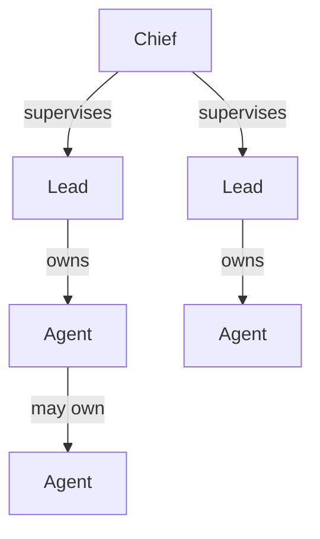

# Coordination

[Documentation index](../README.md)

Pi Herdsman separates supervision, execution ownership, and physical placement.
Those relationships intentionally do not collapse into one global Agent tree.

## Roles



The same model in text:

```text
supervision: Chief -> Lead
ownership:           Lead -> Agent -> Agent
```

### Lead

Every normal session starts as a Lead. A Lead implements work and owns its
direct Agents. A delegation-enabled Agent may in turn own only the Agents its
definition permits.

A Lead and its recursively owned Agent hierarchy form a **herd**.

### Chief

Chief is an optional workspace-neutral supervision mode for one Herdr runtime.
It acts on ordinary Leads that it supervises directly.

Chief can observe bounded descendant summaries but acts only on direct reports.
Chief never gains Agent ownership.

### Agent

An Agent performs one bounded delegated assignment for its exact owner.
Delegation-enabled Agents may own permitted direct Agents. Managed Agents do not
participate in Chief, staff, supervisor, or peer authority.

## Direct edges only

Coordination crosses one authority edge at a time:

| Direction | Interface              | Boundary                          |
| --------- | ---------------------- | --------------------------------- |
| Down      | `staff_*`              | Chief -> direct Lead              |
| Up        | `supervisor_*`         | Lead -> Chief                     |
| Sideways  | `peer_*`               | Lead <-> Lead                     |
| Ownership | `agent_*`, `ask_owner` | owner <-> directly owned Agent    |

A supervisor may observe bounded descendant state without gaining descendant
control. Questions and messages are not implicitly forwarded through
intermediate coordinators.

## Usage follows ownership

Session usage accounting follows the Agent ownership graph, not the supervision
graph. `/agents stats` starts with the current Pi session and walks only
transitively owned managed-Agent sessions whose exact persisted identity can be
verified.

Chief staff, peer Leads, other worktrees, and unrelated Pi sessions are not
attributed through supervision relationships. This keeps usage accounting
aligned with the same durable ownership boundary used for Agent control.

See [Commands](../reference/commands.md#agents-stats) for the exact presentation
and coverage rules.

## System responsibilities

| System          | Responsibility                                                             |
| --------------- | -------------------------------------------------------------------------- |
| **Pi**          | Session history, turns, model interaction, and conversation continuity     |
| **Pi Herdsman** | Coordination, supervision, delegation semantics, and authority validation  |
| **herdr**       | Processes, panes, tabs, workspaces, placement, and Git worktree topology   |
| **Git**         | Branches, commits, and repository state                                    |

Physical layout and display metadata are evidence or presentation, not
coordination authority. Control requires current validated identity and fails
closed when evidence is stale, missing, duplicated, or ambiguous.

## Role transitions

`/chief` enters Chief mode from an eligible ordinary Lead. `/chief leave` returns
to Lead.

Chief mode restores the Lead tool baseline when it is left. Exact eligibility and
command behavior are documented in [Commands](../reference/commands.md).

## See also

- [Delegation](delegation.md)
- [Agents and identity](agents.md)
- [Staff tools](../reference/staff.md)
- [Supervisor tools](../reference/supervisor.md)
- [Peer tools](../reference/peer.md)
